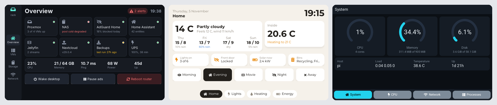
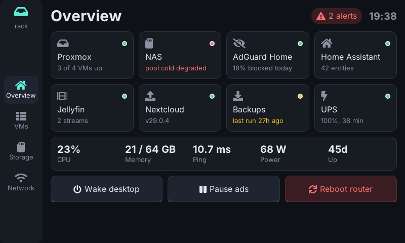
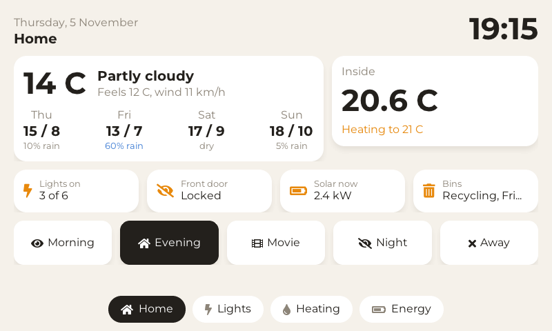
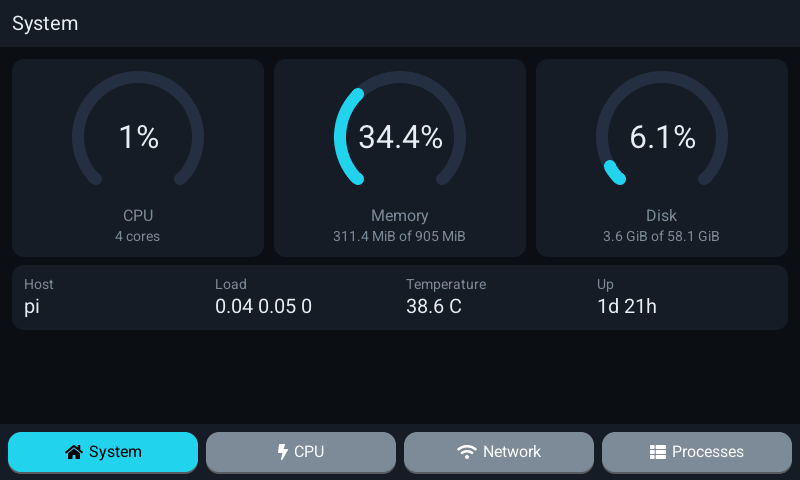

# paneld

**A fast, tiny touch panel you set up with plain config files.**

paneld is a native touch UI that shows live values and runs commands when you tap. It starts in a blink, answers taps at once and needs only a few megabytes of memory and a fraction of a CPU core, so it runs comfortably on small boards like a Raspberry Pi. It is not a kiosk app wrapping a web page: there is no browser and nothing to install beside one binary.

Everything specific lives in short, readable config files: the pages and how they look, where every number comes from, what every button does, what counts as an alert. paneld knows no service by itself: each integration is a command (`curl`, `ssh`, a script), so it works with anything you can reach from a shell.



## Light by design

paneld is one native process: Rust and [LVGL](https://lvgl.io), drawing straight to the screen through DRM/KMS. No browser, no Electron, no X or Wayland, no runtime to install, so it fits on devices with little memory next to everything else they run. Measured on a Raspberry Pi 3B+:

| | |
| --- | --- |
| Binary | one static file, about 3.1 MB (fonts and icons included) |
| Memory | about 4 MB resident (RSS), with six live sources polling |
| CPU | about 0.4% of one core, averaged over 10 minutes of normal running |
| Start | the screen is open about 0.1 s after launch |

Idle means asleep: with nothing changing, paneld waits in `poll` and wakes about once a second for its clocks. A page only redraws when a value it shows changes, sources can poll only while their page is on screen, and after a while without a touch the screen dims and turns off (through your backlight commands; see [Deploy](docs/deploy.md)).

## What it does

- **Pages from building blocks**: text, icons, buttons, toggles, sliders, selects, arcs, bars, charts, images, QR codes, keypads, laid out with rows, columns, grids and stacks. Your own components on top.
- **Live data**: sources poll a command (or stream its output line by line) and parse text, numbers, JSON or lines. History is kept for charts.
- **Actions**: buttons run commands with typed, validated parameters, behind a PIN or a confirmation if you want, with busy, done and failed feedback.
- **Remotes**: describe a machine or service once (`via = ssh`, `http`, `socket`) and use it as `nas.temp` or `nas.reboot` on any page; values are quoted for you.
- **Alerts and reminders**: conditions or events raise a banner, with acknowledge, snooze and history.
- **Themes**: colors, five built-in font families, icons, gradients, images, shadows, motion, and even the layout of the frame around pages. Ship one as a folder, switch at night or from the command line.
- **Safe by default**: UI input reaches commands only as separate arguments or environment variables, never pasted into a shell; secrets are read from files or the environment, never written in the config, and masked in logs and on screen.
- **Never a blank screen**: a broken config is reported with file, line and column, and the last good one stays up. Edits apply live.

A taste of the config format:

```
source cpu_temp {
    poll    = 30s
    run     = cat /sys/class/thermal/thermal_zone0/temp
    parse   = number
    value   = {{ out / 1000.0 }}
    history = 1h
}

action reboot_nas {
    title   = Reboot the NAS
    pin     = true
    confirm = Reboot the NAS now?
    run     = ssh nas sudo reboot
}

page home {
    title = Home
    nav   = 1
    text   { value = CPU {{ round(sources.cpu_temp.value, 1) }} C }
    button { label = Reboot NAS; icon = power; on_tap = reboot_nas }
}
```

## Examples

Three complete configs live in [`examples/`](examples/). Each brings its own theme and demo data, so it runs on any Linux machine as is, and says next to every source what a real setup would run instead.

| | |
| --- | --- |
| [**Homelab rack**](examples/homelab/): services at a glance, VMs you start and stop behind a PIN, storage pools, a latency chart, alerts. Its theme replaces the frame with a side bar. |  |
| [**Smart home**](examples/smart-home/): clock and weather, scenes, lights, a thermostat and the day's solar power, on a warm light theme. Comes with a `remote_kind` for Home Assistant's REST API. |  |
| [**System monitor**](examples/system/): the machine paneld runs on, from `/proc`: gauges, charts with history, top processes. Real data, nothing to set up. |  |

More screenshots are in the [examples README](examples/README.md).

## Try it on a PC

paneld builds on Linux. You need Rust 1.82 or newer, a C compiler, libclang (for bindgen) and SDL2's development files; on Debian or Ubuntu:

```
sudo apt install build-essential clang libclang-dev libsdl2-dev
```

LVGL is a submodule:

```
git clone --recursive https://github.com/lapociampi/paneld
cd paneld
cargo run --release -- -c examples/homelab/paneld.conf
```

The panel opens in an 800x480 window. The homelab demo's PIN is `1234`.

Without a screen, `paneld shot` renders a page to a PNG, with scripted taps, which is how the screenshots here were made:

```
cargo run --release -- shot -c examples/smart-home/paneld.conf --page lights -o lights.png
```

## Run it on a Raspberry Pi

paneld cross-compiles to one static binary with [cargo-zigbuild](https://github.com/rust-cross/cargo-zigbuild) (the toolchain setup is in [Deploy](docs/deploy.md)); nothing is installed on the Pi but the binary, a systemd unit and your config:

```
scripts/build-static.sh aarch64-unknown-linux-musl
scp target/aarch64-unknown-linux-musl/release/paneld pi:/tmp/
```

It picks the display (DRM, then the framebuffer) and the touchscreen by itself, and runs as its own unprivileged user. The steps, the systemd unit and the screen settings (dimming, power off, night mode) are in [Deploy](docs/deploy.md).

## Day to day

- `paneld check` checks a config without running it, with every error's file, line and column.
- `paneld ctl status | goto | set | eval | reload | theme | alert | reminder` talks to the running panel over a Unix socket. There is no network listener.
- `paneld hash-pin` makes the PIN hash.
- Editor support: a syntax highlighting grammar for VS Code (and other TextMate editors) in [`editors/vscode`](editors/vscode/).

## Docs

The design and reference docs are in [`docs/`](docs/index.md):

- [Config format](docs/config-format.md): the syntax.
- [Schema](docs/schema.md): every block, key and expression function.
- [Themes](docs/themes.md): tokens, styles, components, folders.
- [Deploy](docs/deploy.md): building, installing, the Pi.
- [Architecture](docs/architecture.md) and the [design decisions](docs/decisions/index.md) behind it.

The docs are written to be published as is (YAML front matter, relative links); `site/` builds them into a small static site with `cd site && bun install && bun run build`.

## Status

paneld is in daily use. The config schema is at v1 and may still change before a 1.0. Issues and ideas are welcome.

## License

paneld is licensed under the [MIT license](LICENSE).

It bundles [LVGL](https://github.com/lvgl/lvgl) (MIT), [libdrm](https://gitlab.freedesktop.org/mesa/drm) (MIT) and five font families under the [SIL Open Font License](crates/paneld-ui/fonts/): Roboto, Open Sans, Noto Sans, Montserrat and Inter, cut down to Latin-1 (see [their README](crates/paneld-ui/fonts/README.md)).
