# Examples

Three complete configs, each with its own look. They run on any Linux machine as is:

```
cargo run --release -- -c examples/homelab/paneld.conf
cargo run --release -- -c examples/smart-home/paneld.conf
cargo run --release -- -c examples/system/paneld.conf
```

The homelab and smart home configs read demo data from their `demo/` folders and say, above every source and action, what a real setup runs instead; swap them in one at a time and check with `paneld check -c <config>`. The system monitor reads the machine it runs on.

## Homelab rack

[`homelab/`](homelab/): services, VMs, storage and the network of a home server rack. Shows a theme folder whose `shell` component replaces the frame with a side bar (`themes/graphite/`), alerts raised from source values, actions behind a PIN (`1234` in the demo) and a confirmation, an action that asks for a parameter, `repeat` over JSON lists, and gauges built from `arc` and `stack`.

| | |
| --- | --- |
| 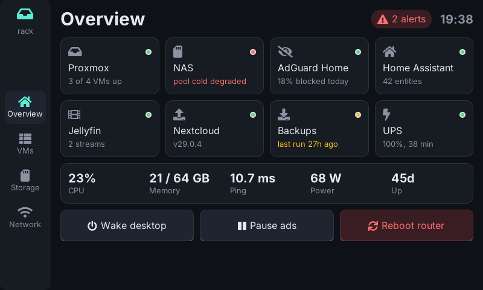 | 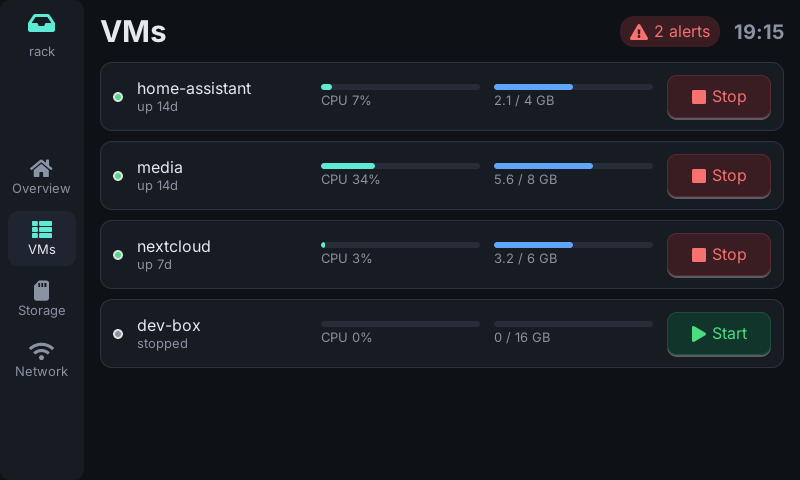 |
| 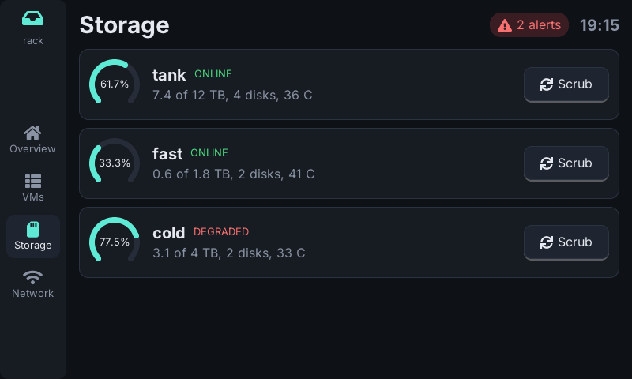 | 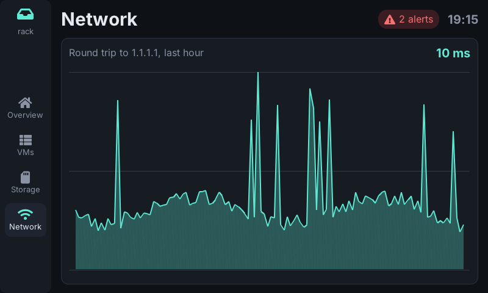 |
| 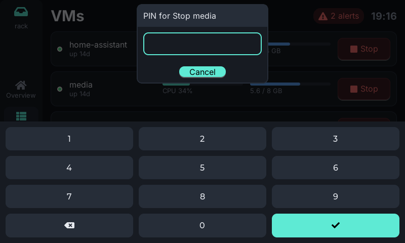 | |

## Smart home

[`smart-home/`](smart-home/): a wall panel with the time, weather, scenes, lights, heating and solar power. Shows a light theme with a large clock (`now`), toggles and a slider bound to `var`s, a thermostat on an `arc`, bar charts, night settings, and a ready `remote_kind` for Home Assistant's REST API (`HA_TOKEN` from the environment).

| | |
| --- | --- |
| 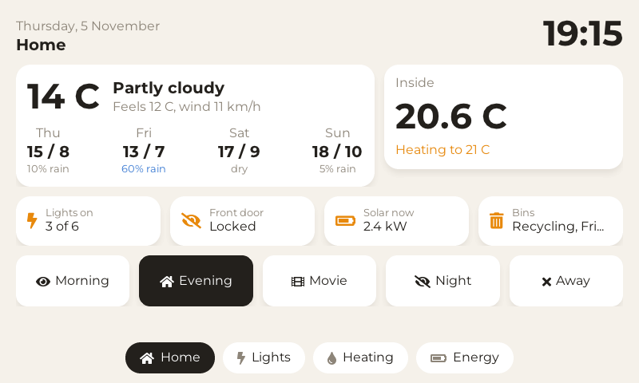 | 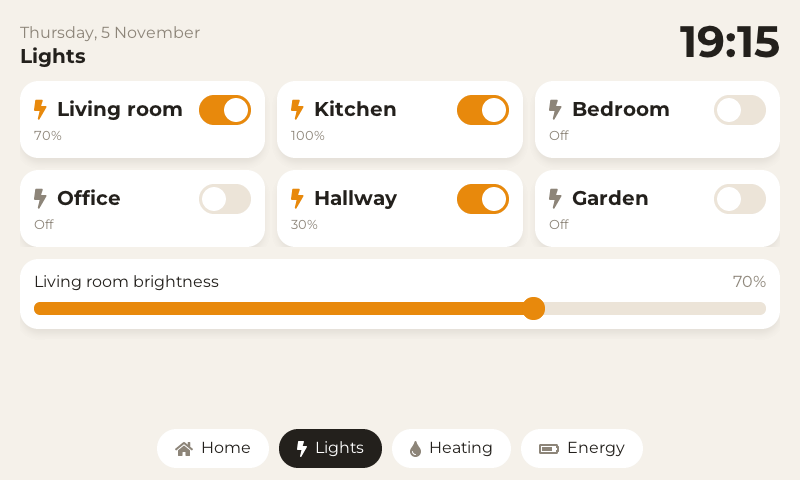 |
| 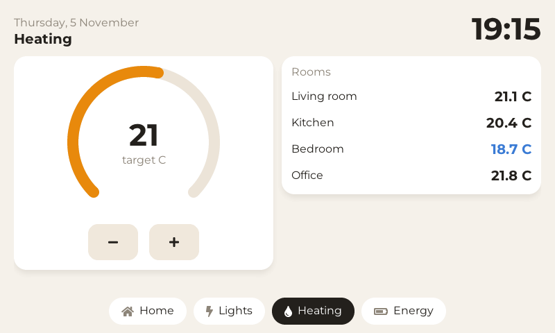 | 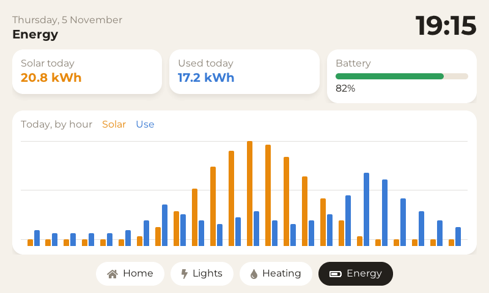 |

## System monitor

[`system/`](system/): CPU, memory, disk, network and processes of the machine paneld runs on, read by one small POSIX script (`stats.sh`) per poll. Shows a theme in a plain included file (`theme.conf`), sources that poll only while their page is on screen (`active = visible`), and charts fed by a source's `history`.

| | |
| --- | --- |
| 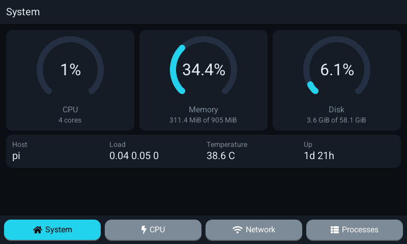 | 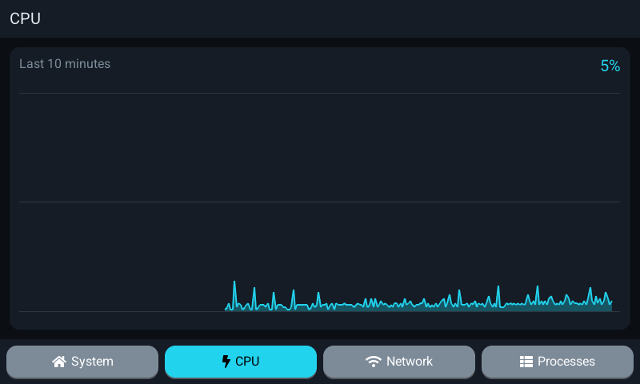 |
| 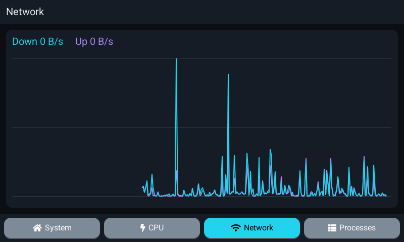 | 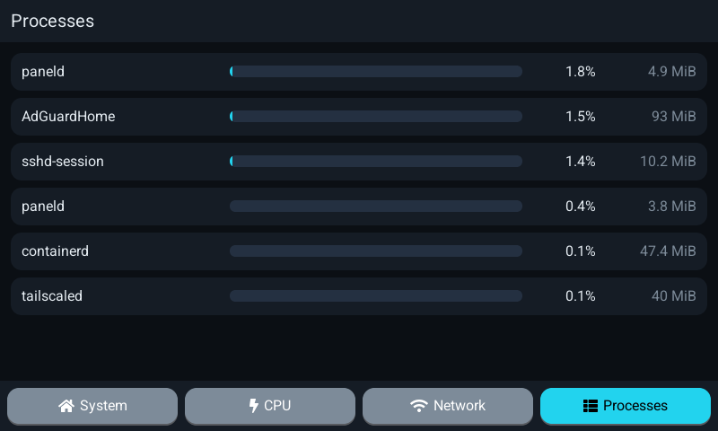 |

The screenshots are made with `paneld shot`, which renders a config headless to a PNG; the system monitor's were rendered on a Raspberry Pi 3B+ (the second `paneld` in its process list is the screenshot run).
